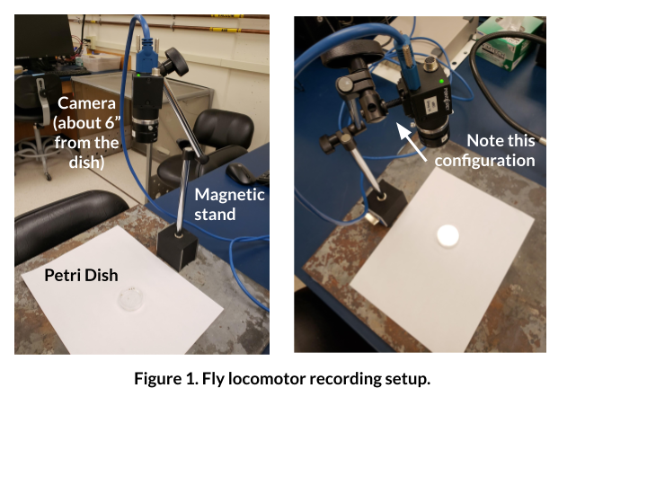
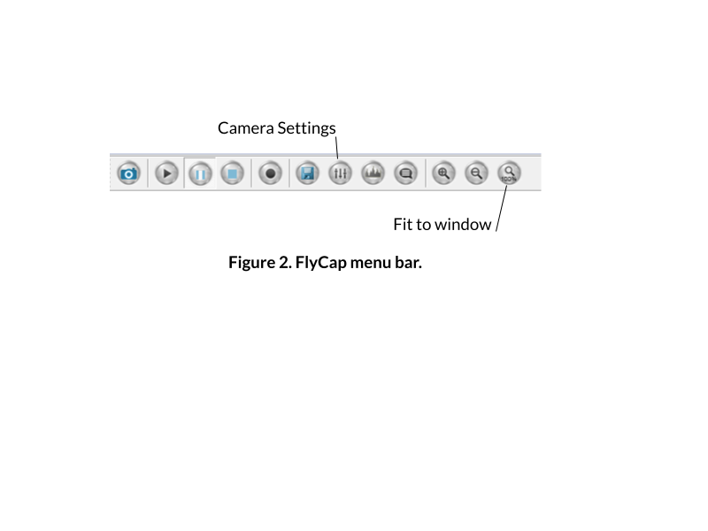
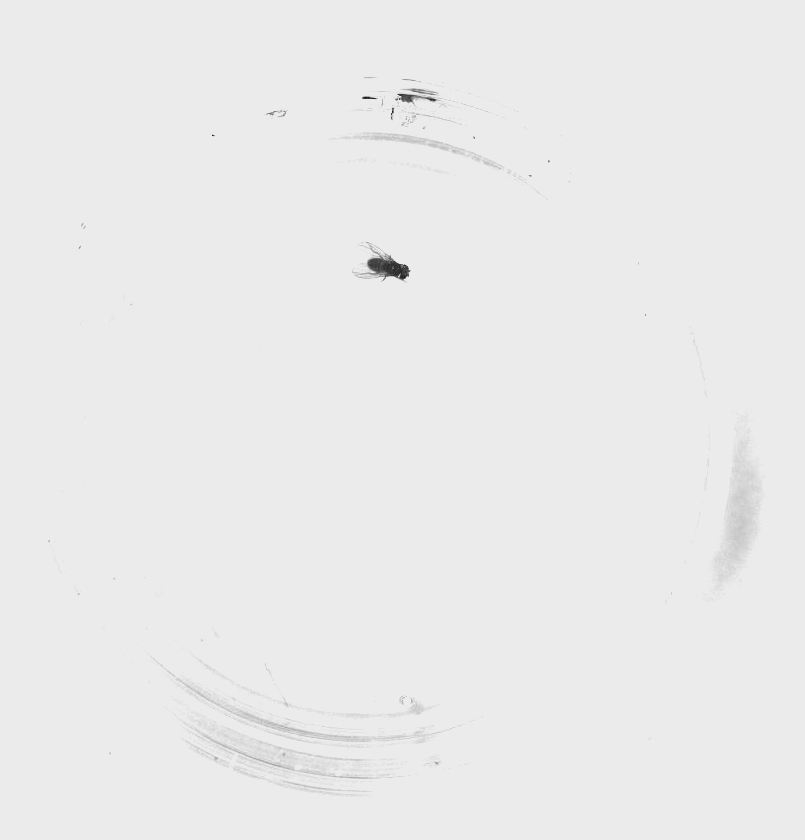
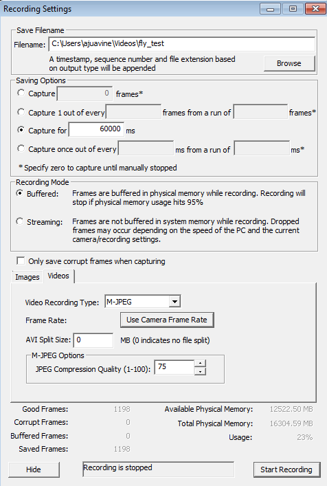

# Recording Locomotor Behavior

In this protocol, you'll record the movement of your flies in a petri dish and use an automated tracking program to measure the velocity and heading of your flies. Your mystery flies might have altered locomotor behavior — this will help you test that.

**Supplies**
* Flea3 camera with USB 3.0 cable
* Magnetic stand
* Petri dish with sylgard bottom
* Paintbrush
* Ice and ice bucket
* Computer with Point Grey FlyCap2
* Vials of mystery flies and wildtype flies

## Set up your camera

First, we need to arrange the camera and petri dish so that you can get everything in frame, in focus, and well lit.

1. Ensure that your camera is connected via the USB cord to the computer. The camera should be plugged into a USB 3.0 slot (the blue ones).
2. Set up your camera and petri dish as in the figure above. You want your camera to be about 6 inches from the petri dish.
3. On the computer, open **Point Grey FlyCap2**.
4. Make sure that it recognizes a "Flea3" camera, and press OK.
5. Adjust the **focal length** knob on your camera (closest to end, ranges from infinity to 0.1) in order to get the image in focus.
6. Adjust the image on your screen using the toolbar at the top:

   

7. Isolate one fly in your petri dish.
8. Click on the button to open up the Camera settings (e.g., exposure).

   a. Uncheck *auto* for brightness, exposure, and shutter.

   b. Increase the exposure almost to the point where your image is overexposed. You want the flies to stand out very clearly against the white background, and the edges of the petri dish to be invisible:

   

9. Ensure that you can easily see your fly throughout all areas of the arena.

:::{admonition} Optimize your video
:class: note
Optimizing the way your fly recording looks will make the tracking *much* easier. Make sure there are no glares from lights in the room, no dark spots on the petri dish, and clean off any fingerprints on the glass. **Every light and dark spot matters, and anything can throw off the tracking.**
:::

## Set up your flies & record

1. When you're ready to record, go to **File > Capture Image or Video**.
2. A dialogue will pop up. Set up a 60 second recording with the following settings:

   - **Filename:** browse to create your own (make sure you label it as WT or Mystery). **SAVE YOUR FILE LOCALLY**, not on your username server. **Your video file will not save correctly if you do not do this.**
   - Capture for 60000 ms
   - Buffered
   - (Click on **Videos** tab)
   - **Video Recording Type:** M-JPEG
   - **Frame Rate:** 15.0
   - **AVI Split Size:** 0
   - **JPEG Compression Quality:** 75

3. Press **Start Recording**, and wait while the program records the video. This window will not close, but the message at the bottom will change.
4. When it is done, **check that the video recorded correctly by finding the file and opening it.** If it didn't record correctly, close FlyCap, unplug the camera, and retry.
5. For the first fly you record, **move on to the next section to ensure that your video works well for tracking. If the tracking doesn't work well, you'll need to adjust your lighting and/or image acquisition.**
6. When you're confident the tracking works well with your videos, obtain videos for three flies from each group (you've already done one).
7. When you're done, save your videos in a clouded location for safekeeping.
8. Close FlyCap.

## Quantify your locomotor behavior

Now that you have videos of your specimen, you need to quantify the locomotor behavior. You can do so using [this notebook](https://bipn145.github.io/FlyTracking/ColabNotebook.html), which will generate means and standard deviations for each video.

Record those values in the table below (you'll ultimately want to plot these).

**Table 2.** Comparison of mean velocities for wildtype and mystery flies.

|  | **Wildtype** | **Mystery flies** |
|---|---|---|
| Mean | | |
| SEM | | |

:::{admonition} Guesses, please!
:class: tip
Would you expect activating sweet- or bitter-sensing neurons to change how fast a fly walks? Do your data suggest a difference between your mystery flies and wildtype flies?
:::

## Troubleshooting

| **Observation** | **Likely issue(s)** | **Possible solution** |
|---|---|---|
| The camera output is black | Lens cap is on | Remove the lens cap |
| Camera not recognized | Camera not plugged in | Plug in the camera |
| Video file is not recognized or the movie is the wrong length/size | You wrote the video file to the server | You need to re-record your video but with the file saved **directly to the computer locally** |
| All flies look the same in tracking video | Lighting/exposure issues | Increase exposure so flies stand out as dark spots on a fully white background |
