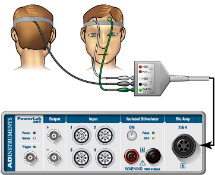
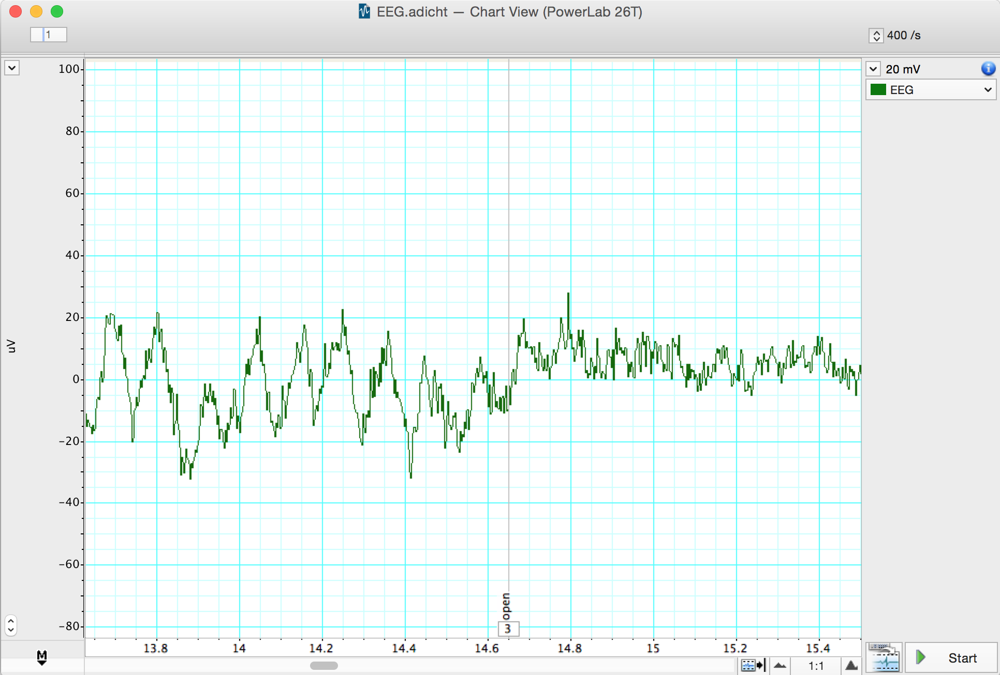
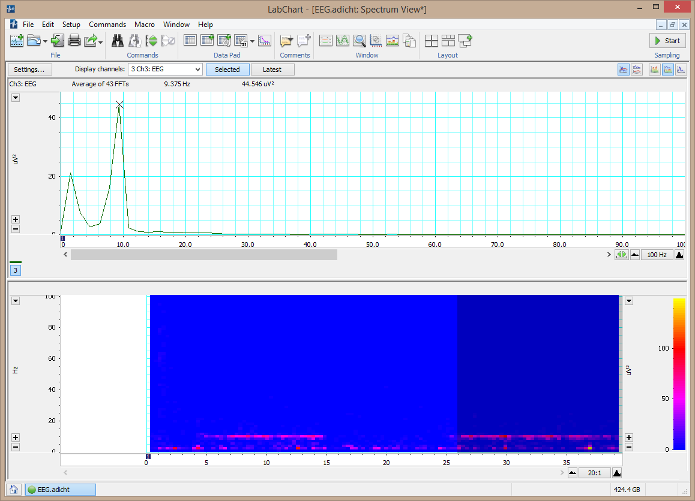

# Detecting Alpha Waves

## Supplies
* LabChart software & computer
* PowerLab 26T
* 5 Lead Shielded Bio Amp Cable
* EEG Flat Electrodes (gold contacts)
* Electrode paste
* Abrasive Gel (NuPrep)
* Alcohol swabs
* Elastic bandage
* Cotton swab

## Equipment Setup and Electrode Attachment

1. Make sure the PowerLab is turned **off** and the USB cable is connected to the computer.
2. Connect the 5 Lead Shielded Bio Amp Cable to the Bio Amp Connector on the front panel of the PowerLab (Figure 1). The hardware needs to be connected **before** you open the settings file.

*Figure 1. Equipment setup for PowerLab 26T. Image courtesy of ADInstruments ©*

3. Attach the leads of the EEG Flat Electrodes to the Earth, CH1 NEG and POS pins closest to the labeled side on the Bio Amp Cable. Channel 1 "**positive**" will lead to the inion (the bump on the back of the head above the neck) and Channel 1 "**negative**" will lead to the forehead. Channel 2 will be empty and the Earth will lead to the temple. Refer to Figure 1 for proper placement, but do not attach them to the volunteer yet. Follow the color scheme on the Bio Amp Cable.
4. Remove any jewelry from the volunteer's face, ears, and neck.
5. With Figure 1 as a guide, locate where you will place the electrodes. Abrade the skin with the NuPrep Abrasive Gel.

   **Note:** This is important as abrasion helps reduce the skin's resistance. Your recordings will be much better if you have abraded the skin well (but not too much — that will cause irritation).

6. After abrasion, clean the area with an alcohol swab to remove the dead skin cells.
7. While the skin is drying, scoop Electrode Paste into the EEG Flat Electrodes. When the skin is dry, stick the electrodes to the skin (Figure 1). Immediately hold the electrodes and wires in place with the medical tape. Make sure the tape firmly holds the electrodes against the head. Use the elastic bandage to wrap tightly around the head. This will help the electrodes maintain good contact with the skin.
8. Have the volunteer lie in a comfortable position on his/her back (or sit comfortably), with the head turned so that none of the electrodes are disturbed or compressed.
9. Check that all three electrodes are properly connected to the volunteer and the Bio Amp Cable before proceeding. Turn on the PowerLab.

## Exercise 1: Recognizing Artifacts

In this exercise, you will learn to recognize some of the artifacts that can appear on an EEG.

1. Launch LabChart with the EEG Settings file ([http://bit.ly/labchart](http://bit.ly/labchart)).
2. Go to Setup > Channel Settings and click on the **Bio Amp** button. In the window that opens, make sure the settings are as follows: **Range 200 µV, High Pass 0.5 Hz, and Low Pass 50 Hz**.

:::{admonition} Questions for reflection
:class: tip
- Why are we applying high- and low-pass filters to our data?
:::

3. **Start** recording. Add a **comment** "blinking," and have the volunteer blink repeatedly. **Stop** recording after 10 seconds.
4. Repeat step 3, this time, have the volunteer make eye movements. Add a **comment** "eye movements." Have the volunteer gaze up-and-down and left-and-right in a repeated pattern. Make sure the volunteer's head is still and only the eyes move.
5. Repeat step 3, this time, have the volunteer make head movements. Add a **comment** "head movements." Have the volunteer gently move his/her head in a repeated pattern.
6. Examine the vertical scale at the left of the Chart View, and note the positions corresponding to +50 µV and −50 µV. At rest (when your volunteer is not blinking or moving their head), the EEG recording should not exceed these limits. *It is okay if it goes beyond -50 µV or above 50 µV when the person is blinking or moving.* If your signal exceeds these limits, please ensure that the electrode on the back of the head is making electrical contact with the scalp and reposition if necessary. 
7. **Save your data**, and open a new file with the same settings.

## Exercise 2: Alpha Waves in the EEG

In this exercise, you will examine the effects of relaxation and eye movement on alpha waves in the EEG.

1. Make sure the volunteer is relaxed and comfortable. Have the volunteer close his/her eyes and remain quiet. Keep noise to a minimum and keep all distractions away from the volunteer.
2. **Start** recording. Prepare a comment with "open"; do not enter it yet.
3. Tell the volunteer to open both eyes. Immediately press Return/Enter to add the **comment**. Record with the volunteer's eyes open for 30 seconds. Do not stop recording.
4. Prepare a comment with "shut." When the 30 seconds are complete, tell the volunteer to close both eyes. Immediately press Return/Enter to add the **comment**. The participant should keep their eyes closed for 30 seconds.
5. Repeat steps 3 and 4 nine times to give you ten total repeats of each condition (10 minutes of recording). **Save your data**.

*EEG signal with eyes shut and open. Note alpha waves during eyes shut (left).*

## Wave Amplitude Analysis

1. Use the **View Buttons** to change the horizontal compression to see data with eyes open and shut. Make a data selection that includes some data from both eyes open and eyes shut conditions. You can view this selection in **Zoom View**, which might make it easier to see the alpha wave activity. **Autoscale**, if necessary.
2. In Chart View, scroll through the parts of the recording that were made with the volunteer's eyes shut to look for alpha waves. Use the **View Buttons** to change the horizontal compression so that you are only observing about 2 seconds of data, similar to the image above. The alpha waves can be recognized by their amplitude (usually 30 to 50 µV peak-to-peak) and their frequency. Each cycle of an alpha wave lasts ~0.1 s.
3. Use the **Marker** and **Waveform Cursor** to measure the amplitude of the alpha waves. Place the **Marker** at the lowest point of the wave and move the **Waveform Cursor** to the peak of the wave. Measure the amplitudes of 10 waves from when the volunteer's eyes were closed. It's okay if these waves are adjacent or from different trials. Record the values in **Table 1** of the Data Notebook.
4. Now measure wave amplitudes when the volunteer's eyes were open. Record these values in **Table 1** of the Data Notebook.

## Spectral Analysis

Now you will use Spectral Analysis to examine the EEG you recorded.

1. Find the part of the recording when the volunteer had their eyes ***shut***. Click-and-drag across this part of the data trace to **select** it.
2. From the **Window** menu, select **Spectrum**. In the Spectrum View, choose **Selected** (underneath the main toolbar at the top).

*Spectrum of an EEG*

3. Next to Display Channels, choose Ch 3: EEG.
4. Alpha activity should show up in the PSD plot as a clear peak in the 8–13 Hz range.
5. Alpha activity shows up in the Spectrogram as a band of color in the 8–13 Hz range. If you cannot see the alpha activity as a clear peak in the 8–13 Hz range, manually scale the horizontal and vertical axes. Note that Spectrogram displays all the recorded data and that the selection you have made is highlighted in a darker blue color.

:::{admonition} Scale your spectrogram
:class: tip
If your spectrogram looks all pink or blue, you can manually set the scale similar to how you did in the [Spectral Analysis Tutorial](https://bipn145.github.io/LabManual/EEGSpectralAnalysis.html) Step #14. Note the very small values in the default visualization, typically on the order of e^-09. Try making these smaller (e.g. e^-11) to be able to more easily visualize power changes in your data. 
:::

6. Make a data selection of several seconds from when the volunteer had their eyes ***open***. Select **Spectrum**. Note that in the PSD plot the peak in the alpha activity range of 8–12 Hz is small or absent, and in the Spectrogram the band of color in the alpha activity range of 8–13 Hz is weak or absent.
7. In the Spectrogram, scale the horizontal axis so that all the data is visible. Note the presence and absence of the band of color in the alpha range, which corresponds with the eyes shut and eyes open conditions.
8. If you're happy with your spectrograms (e.g., you can clearly see alpha activity in closed conditions but not open conditions), you've completed the task for this lab. Save your data in a clouded location.

:::{admonition} Questions for reflection
:class: tip
- Under what conditions did you see alpha waves more clearly?
- What are alpha waves thought to indicate?
- Look at your Spectral Analysis from when the volunteer had their eyes closed. At what range do you have the greatest peak? What type of brain waves does the Spectral Analysis suggest is active?
:::

## Analyzing your EEG data

1. Export 30 seconds of one closed trial and one open trial for your analysis. [See this page if you need a reminder](https://bipn145.github.io/LabChart/ExportingLabChart.html).
2. Using this notebook, you can generate plots from your EEG data: https://bipn145.github.io/Python/SpectralAnalysis.html 

### Data Notebook

**Table 1. Alpha Waves with Eyes Open and Closed**

| | Eyes Open Amplitude (µV) | Eyes Closed Amplitude (µV) |
|---|---|---|
| **Wave #1** | | |
| **Wave #2** | | |
| **Wave #3** | | |
| **Wave #4** | | |
| **Wave #5** | | |
| **Wave #6** | | |
| **Wave #7** | | |
| **Wave #8** | | |
| **Wave #9** | | |
| **Wave #10** | | |
| **AVERAGE** | | |
| **STANDARD DEVIATION** | | |
