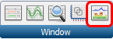
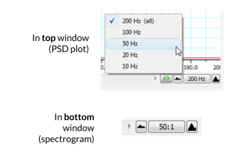
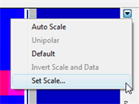
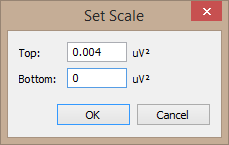

# Spectral Analysis Tutorial

A spectrum is a representation of data based on the frequency distribution of its component sine waves. Spectra indicate the strength of the various frequencies in a time-varying waveform. Spectrum View allows you to observe the frequency distribution of data that might not otherwise be easily seen. For example, it could be used to break down an EEG waveform into its various components: beta waves, alpha waves, theta waves and delta waves. A mathematical technique known as the Fast Fourier Transform is applied to the raw data. The results of this analysis can be displayed as a plot of the power (vertical axis) of different frequencies (horizontal axis) relative to each other in the input signal. This is called a **Power Spectrum Density (PSD) plot**. The data can also be displayed as a 3-dimensional color plot of spectral power, frequency, and time, called a **Spectrogram**.

**Note:** The questions here are written to ensure that you are understanding the steps of the tutorial. You do not need to answer them, and they do not directly relate to your lab report. You *should*, however, understand how to interpret a spectrogram.

1. Open the EEG Spectral Analysis Tutorial settings file ([http://bit.ly/labchart](http://bit.ly/labchart)).
2. Examine the Chart View. Use the **View Buttons** to view each block. You should see five blocks of data. The first record is a slowly oscillating sine wave.
3. Open Spectrum view by clicking on the Spectrum View button in the Toolbar:

   

4. Click the **Smart Tile** button in the LabChart Toolbar to display both windows in full screen mode.
5. In Chart View, **select** the first record by double-clicking in the Time axis. This will perform a spectral analysis for this record and display the result in the Spectrum view.
6. Adjust the horizontal scaling of plots to view the results:

   - Set the **horizontal scaling** for the **Power Spectrum Density (PSD)** plot to 50 Hz.
   - Use the horizontal scroll bar to display the 0 Hz to 50 Hz region of the plot.
   - You may need to Autoscale the axes.
   - Set the **horizontal scaling** for the Spectrogram to 50:1.

   

7. Examine the PSD plot and then the first section of the Spectrogram. Expand the vertical axes if necessary. Use the waveform cursor to identify the frequency in Hertz (Hz) of the peak in the PSD plot and the band in the Spectrogram. Values are displayed at the top of each plot.
8. Select the second record and again view the result in the Spectrum view.
9. Select the third record and again view the result in the Spectrum view. You should now see two prominent peaks (PSD plot) and bands (Spectrogram) in the result.
10. Select the fourth record and again view the result in the Spectrum view.

:::{admonition} Quiz Questions
:class: attention
- What is the frequency in Hertz (Hz) of the first sine wave?
- What is the frequency in Hertz (Hz) of the second sine wave?
- Are the two peaks/bands you see in record 3 the same as for the first two records? How is this possible?
:::

11. In Chart View compare the signal amplitudes of the fourth and fifth records. Note that the fifth record has lower amplitude compared with the fourth record (you may need to Autoscale to see a peak at all).
12. Select the fourth record again. In the Spectrum view examine the PSD plot. Move the **Waveform Cursor** to the prominent peak.
13. Select the fifth record and examine the PSD plot. Move the **Waveform Cursor** to the peak.

:::{admonition} Quiz Questions
:class: attention
- What is the frequency (Hz) of the signal in record 4?
- What is the power (mV²) of the signal in record 4?
- What is the frequency (Hz) of the signal in record 5?
- What is the power (mV²) of the signal in record 5?
:::

14. Examine the Spectrogram. Note that the band corresponding to the signal's frequency appears to be missing. This is because the power of the signal is small compared with the previous four records. Expand the scale on the right-hand side of the Spectrogram by setting the scale closer to the power of the signal (e.g., right-click **Set Scale** to 0 to 0.004 V²). Note that the band is now visible at the expected frequency.

     

15. The fifth record is the same signal as the fourth record, except that the quality of the raw signal has been affected. Compare your features (amplitude, power, frequency) of the fourth and fifth records.

:::{admonition} Quiz Question
:class: attention
- Has the quality of the signal (e.g. its amplitude) impacted what you're able to detect in the power spectral density (PSD) plot (assuming you have it scaled to be able to see any bumps in the PSD?)
:::
