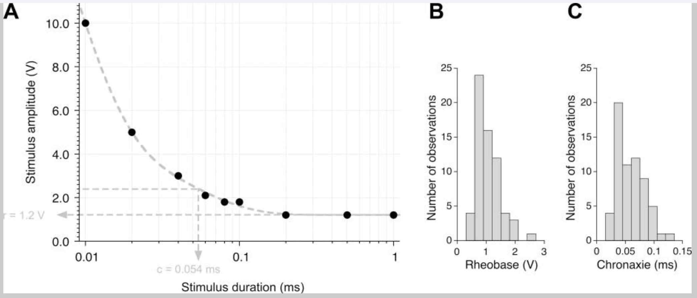

# Earthworm Electrophysiology

## Background & Goals

### Earthworm essentials

Earthworms are a member of the Annelida phylum, which includes segmented worms such as the ragworm and our soon-to-be-friend, the leech. We'll be working with earthworms in the Lumbricidae family.

Earthworms are laid out with a mouth at one end, and an anus at the other. In the middle is the clitellum, a reproductive gland that can secrete a material that helps them form a cocoon. The clitellum is only visible in older worms that are ready to reproduce.

Earthworms have a closed nervous system, with one main blood vessel running down the length of their body. They breathe through their skin, so it is important to keep it moist. They crawl using muscles that are located just underneath the epidermis.

### Earthworm nervous system

Earthworms have a pretty simple brain: it's actually a fused pair of nerve ganglia, mostly located in their third segment. The earthworm has one main nerve cord on its ventral (bottom) side with three fibers running through it: one medial giant fiber, and two lateral giant fibers.

These fibers are big bundles of axons. They serve as high-speed motor pathways that enable the worm to send movement signals throughout its body for quick, stereotyped reflexes.

Each giant fiber is made up of large individual cells (one per segment) that are electrically coupled to each other through gap junctions. This results in the rapid conduction of action potentials from cell to cell so that each giant fiber behaves as though it were a single axon. There are cross-connections between the medial and lateral fibers, so they often function as one unit.

**These fibers differ in important ways.** The medial giant fiber transmits information from skin cells in the anterior (mouth) end of the worm, and the lateral giant fibers transmit information from the skin cells of the posterior end of the worm.

**It's quite easy to listen in to the activity of these large fibers, even from the skin of the earthworm.** Importantly, these fibers fire action potentials very rarely. This type of nervous system activity is often called sparse coding. That means that we should be able to elicit one action potential and cleanly record it.

*Images from [Backyard Brains](https://docs.backyardbrains.com/retired/experiments/speed), © 2009–2026, used under a Creative Commons Attribution-ShareAlike license.*

### Properties of action potentials

In this lab, we'll determine the **threshold**, **rheobase & chronaxie**, and **conduction velocity** for the earthworm giant fiber system. We're recording compound action potentials (CAPs) from many axons in these fiber bundles, but the underlying principles are the same.

The **threshold** is defined as the minimum stimulus voltage that elicits an action potential 50% of the time. We'll determine this with short stimuli. Stimulus voltages that don't elicit an action potential are called subthreshold; stimulus voltages that do elicit an action potential are called suprathreshold.

In some neurons, we can elicit an action potential with a lower stimulus voltage if the stimulus length is longer. A longer stimulus length enables charge to build up that can ultimately elicit an action potential. However, there is a minimum stimulus voltage needed, even at infinite stimulus durations. The **rheobase** is defined as the minimum stimulus voltage that can elicit an action potential with very long durations of the stimulus. The stimulus duration at 2× the rheobase is called the **chronaxie**. Chronaxie is a useful measure of the excitability of a nerve — the most excitable nerves have the smallest chronaxie. We can plot this data in a strength duration curve: 

**In these experiments you will:**
- Stimulate the ventral nerve cord of the earthworm to elicit an action potential
- Determine the voltage that is needed to recruit the lateral giant fibers
- Calculate the speed of an action potential
- Propose your own hypothesis about conduction velocity
- Conduct your experiment to test your hypothesis

### References

- Bähring, R. & Bauer C.K. (2014) Easy method to examine single nerve fiber excitability and conduction parameters using intact nonanesthetized earthworms. *Advances in Physiology Education* 38(3): 253–264.
- Bullock, T.H. (1945) Functional organization of the giant fibre system of Lumbricus. *J Neurophysiol* 8:54–71.
- Drewes CD, Landa KB, McFall JL (1978) Giant nerve fibre activity in intact, freely moving earthworms. *J Exp Biol* 72:217-227.
- Kladt et al. (2010) Teaching basic neurophysiology in intact earthworms. *JUNE* 9(1):20-35.
- Rudell & Fox (1991) The Propagation potential: An Axonal response with implications for scalp-recorded EEG. *Biophysical Journal* 60: 556-567.
- Shannon et al. (2014) Portable conduction velocity experiments using earthworms for the college and high school neuroscience teaching laboratory. *Advances in Physiology Education* 38(1): 62-70.

Next: the [lab protocol](EarthwormProtocol.md).
